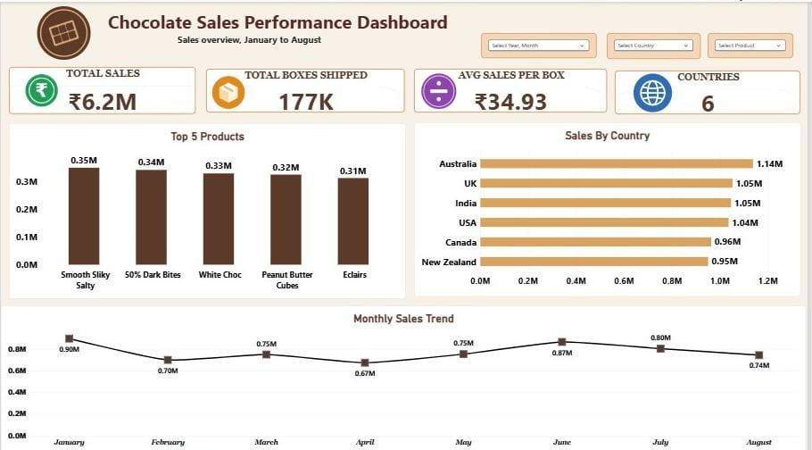
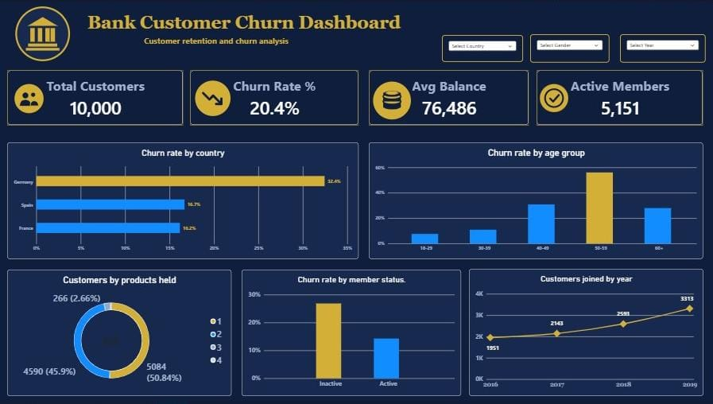
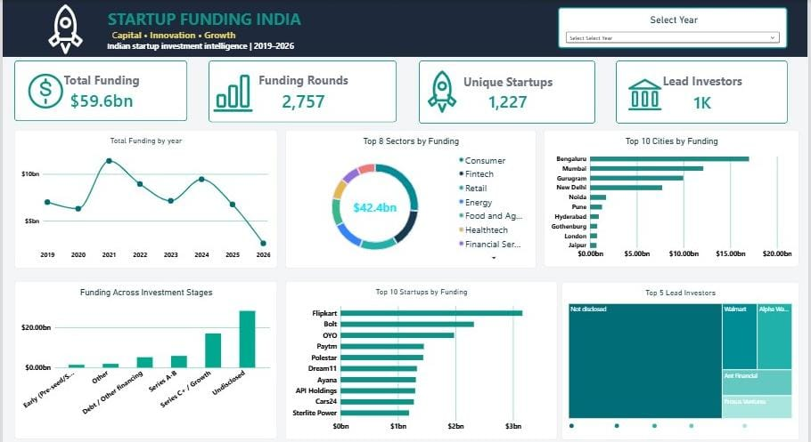

# Power BI Dashboard Portfolio

A collection of three interactive Power BI dashboards covering sales, banking and startup funding analysis. Each project follows the same workflow: clean the data in **Power Query**, create measures in **DAX**, and build an interactive report in **Power BI Desktop**.

| # | Dashboard | Domain | Focus |
|---|---|---|---|
| 1 | Chocolate Sales Performance | Sales | Products, countries and monthly trend |
| 2 | Bank Customer Churn | Banking | Why customers leave |
| 3 | Startup Funding India | Finance / Startups | Where funding goes (2019-2026) |

---

## 1. Chocolate Sales Performance Dashboard

Sales overview from January to August, with slicers for Year/Month, Country and Product.



### Key Metrics

| Metric | Value |
|---|---|
| Total Sales | ₹6.2M |
| Total Boxes Shipped | 177K |
| Avg Sales per Box | ₹34.93 |
| Countries | 6 |

### Visuals Included

- **Top 5 Products** – column chart (Smooth Sliky Salty, 50% Dark Bites, White Choc, Peanut Butter Cubes, Eclairs)
- **Sales by Country** – bar chart (Australia, UK, India, USA, Canada, New Zealand)
- **Monthly Sales Trend** – line chart from January to August

### Key Insights

- Australia is the top country with 1.14M in sales, and New Zealand is the lowest with 0.95M.
- Sales across the top 5 products are very close (0.31M to 0.35M), so no single product dominates.
- January is the best month (0.90M) and April is the weakest (0.67M).
- Sales recovered in June (0.87M) after the dip in April.

---

## 2. Bank Customer Churn Dashboard

Customer retention and churn analysis, with slicers for Country, Gender and Year.



### Key Metrics

| Metric | Value |
|---|---|
| Total Customers | 10,000 |
| Churn Rate | 20.4% |
| Avg Balance | 76,486 |
| Active Members | 5,151 |

### Visuals Included

- **Churn Rate by Country** – bar chart (Germany, Spain, France)
- **Churn Rate by Age Group** – column chart (18-29, 30-39, 40-49, 50-59, 60+)
- **Customers by Products Held** – donut chart
- **Churn Rate by Member Status** – column chart (Active vs Inactive)
- **Customers Joined by Year** – line chart (2016 to 2019)

### Key Insights

- Germany has the highest churn at 32.4%, about double Spain (16.7%) and France (16.2%).
- The 50-59 age group has the highest churn rate, well above the other age groups.
- Inactive members churn at a much higher rate than active members.
- About 51% of customers hold 1 product and about 46% hold 2 products, while very few hold 3 or more.
- New customers joining each year grew steadily from 1,951 in 2016 to 3,313 in 2019.

---

## 3. Startup Funding India Dashboard

Indian startup investment intelligence from 2019 to 2026, with a Select Year slicer.




### Key Metrics

| Metric | Value |
|---|---|
| Total Funding | $59.6bn |
| Funding Rounds | 2,757 |
| Unique Startups | 1,227 |
| Lead Investors | 1K |

### Visuals Included

- **Total Funding by Year** – line chart
- **Top 8 Sectors by Funding** – donut chart (Consumer, Fintech, Retail, Energy, Food and Agri, Healthtech, Financial Services and more)
- **Top 10 Cities by Funding** – bar chart (Bengaluru, Mumbai, Gurugram, New Delhi, Noida and more)
- **Funding Across Investment Stages** – column chart
- **Top 10 Startups by Funding** – bar chart (Flipkart, Bolt, OYO, Paytm, Polestar and more)
- **Top 5 Lead Investors** – treemap

### Key Insights

- Bengaluru receives the highest funding among all cities, followed by Mumbai and Gurugram.
- Consumer and Fintech are among the top funded sectors.
- Flipkart is the top funded startup in the dataset.
- A large share of funding comes from rounds with undisclosed stage and undisclosed lead investors.
- Funding peaked around 2021 and shows another high point in 2024.

> **Data note:** 2026 data is incomplete (the year is not finished), so the drop at the end of the line chart does not represent a real decline in funding.

---

## Tools Used

- **Power Query** – data cleaning and transformation
- **DAX** – measures and calculations
- **Power BI Desktop** – data modelling and visualisation

## Project Structure

```
power-bi-dashboards/
├── README.md
├── Chocolate Sales Dashboard.pbix
├── Bank Customer Churn Dashboard.pbix
├── Startup Funding India Dashboard.pbix
└── images/
    ├── dashboard_page_01.jpeg
    ├── dashboard_page_02.jpeg
    └── dashboard_page_03.jpg
```

## How to Use

1. Download any `.pbix` file from this repository.
2. Open it in **Power BI Desktop**.
3. Use the slicers and click on any visual to explore the data.
