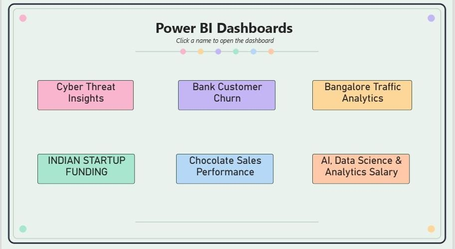
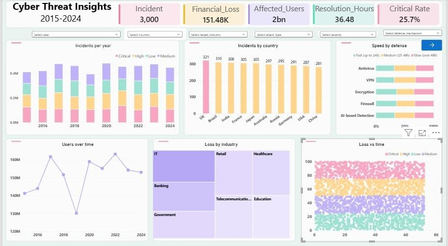
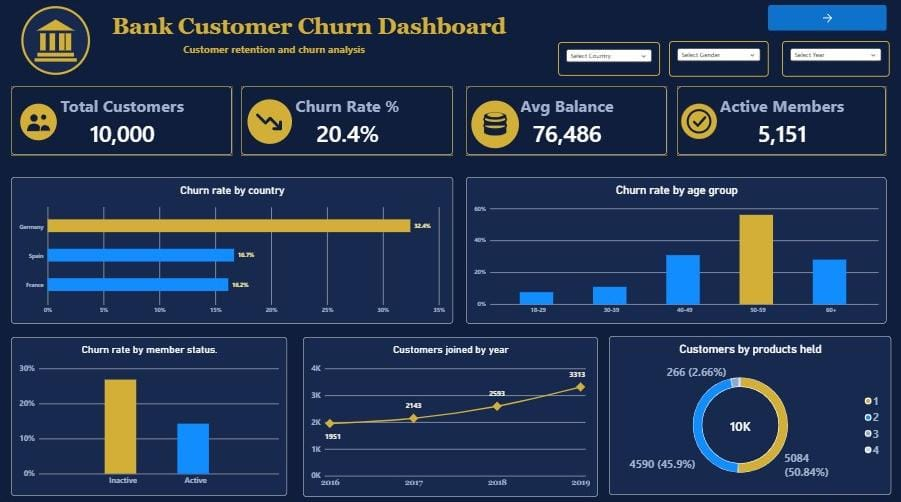
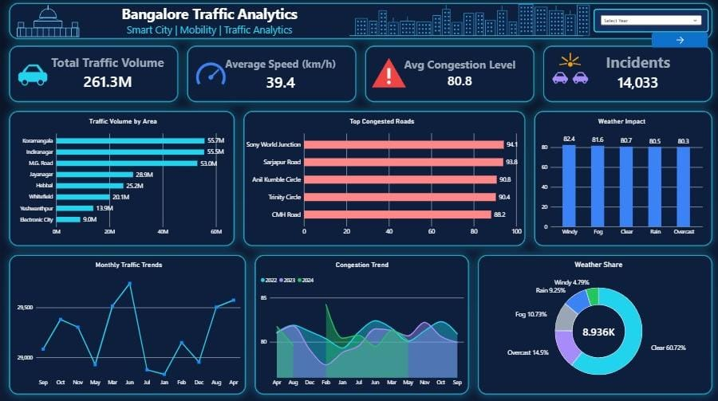
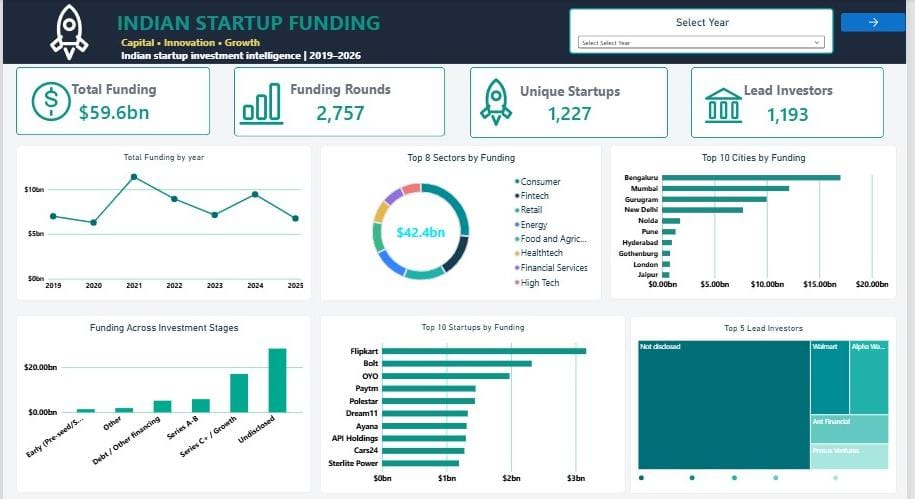
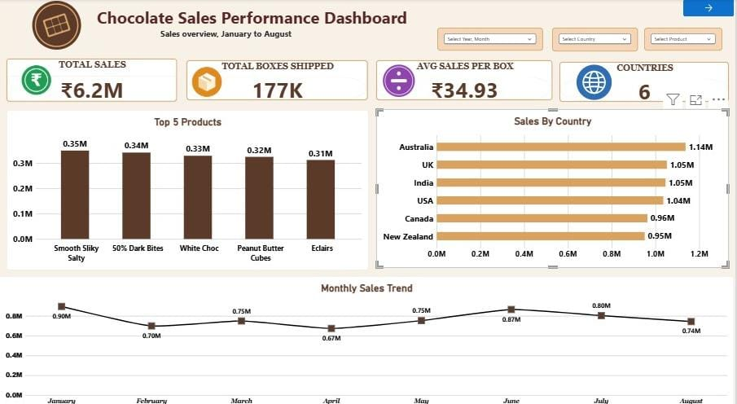
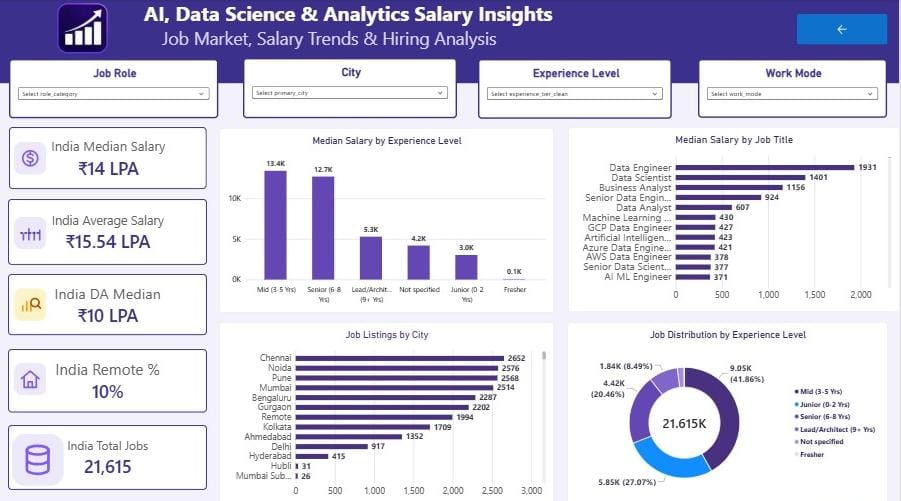

# Power BI Dashboards Portfolio

Hi, I'm **Chandana**, an aspiring Data Analyst / Power BI Developer from Bengaluru, India. This repo has 6 interactive Power BI dashboards I built to practise data cleaning, modelling and visual storytelling.

**Tools used:** Power BI Desktop, Power Query, DAX, Excel, SQL (MySQL)

📁 **Download the full report:** [`Dashboard_Portfolio.pbix`](Dashboard_Portfolio.pbix)

---

## Home Page
The report opens with a navigation page. Click a dashboard name to jump to it.

---

## 1. Cyber Threat Insights (2015-2024)

**Dataset:** Global Cybersecurity Threats 2015-2024 (Kaggle)

**KPIs:** 3,000 incidents | 2bn affected users | 36.48 avg resolution hours | 25.7% critical rate

**Key insights**
- UK has the most incidents (321), followed by Brazil and India.
- IT is the industry with the biggest financial loss.
- Compared how fast different defense mechanisms (Antivirus, VPN, Firewall, AI-based detection) resolve incidents.

---

## 2. Bank Customer Churn

**KPIs:** 10,000 customers | 20.4% churn rate | 76,486 avg balance | 5,151 active members

**Key insights**
- Germany has the highest churn (32.4%) vs Spain (16.7%) and France (16.2%).
- The 50-59 age group churns the most.
- Inactive members churn far more than active members.

---

## 3. Bangalore Traffic Analytics

**KPIs:** 261.3M traffic volume | 39.4 km/h avg speed | 80.8 avg congestion level | 14,033 incidents

**Key insights**
- Koramangala, Indiranagar and M.G. Road have the highest traffic volume.
- Sony World Junction (94.1) and Sarjapur Road (93.8) are the most congested.
- Clear weather makes up about 61% of records; weather impact on congestion is small.

---

## 4. Indian Startup Funding (2019-2026)

**KPIs:** $59.6bn total funding | 2,757 funding rounds | 1,227 startups | 1,193 lead investors

**Key insights**
- Bengaluru leads all cities in funding, followed by Mumbai and Gurugram.
- Funding peaked in 2021.
- Flipkart is the top funded startup, followed by Bolt and OYO.

---

## 5. Chocolate Sales Performance

**KPIs:** ₹6.2M total sales | 177K boxes shipped | ₹34.93 avg sales per box | 6 countries

**Key insights**
- Australia is the top market (1.14M), followed by UK and India.
- Smooth Sliky Salty is the best selling product.
- Sales were highest in January (0.90M) and lowest in April (0.67M).

---

## 6. AI, Data Science & Analytics Salary Insights

**KPIs:** ₹14 LPA India median salary | ₹15.54 LPA average | ₹10 LPA Data Analyst median | 21,615 jobs

**Key insights**
- Chennai, Noida and Pune have the most job listings.
- Mid-level (3-5 yrs) roles make up the largest share (about 42%) of jobs.
- Only about 10% of roles are remote.

---

## How to use
1. Download `Dashboard_Portfolio.pbix`.
2. Open it in **Power BI Desktop** (free).
3. Use the slicers and the home page buttons to explore.

## Contact
- LinkedIn: [Chandana B](https://www.linkedin.com/in/chandana-b-5569b53b5)
- Email: chandanab0904@gmail.com
